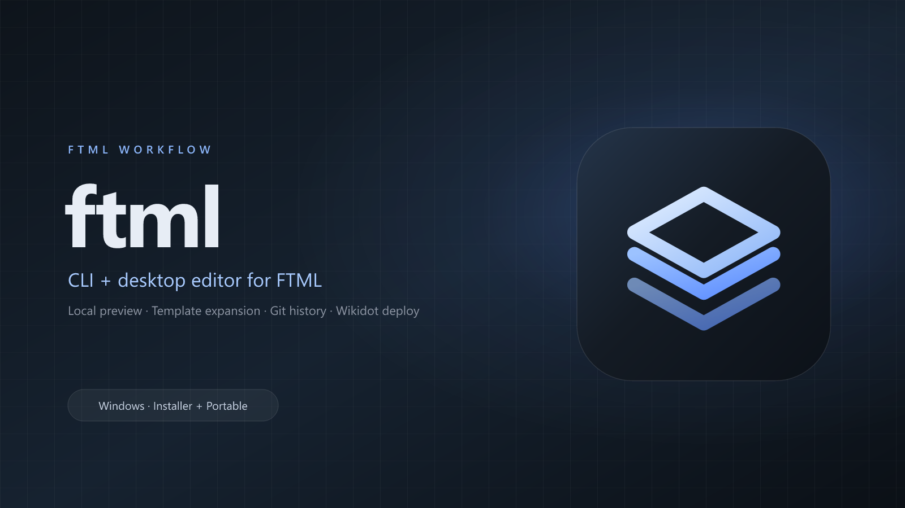
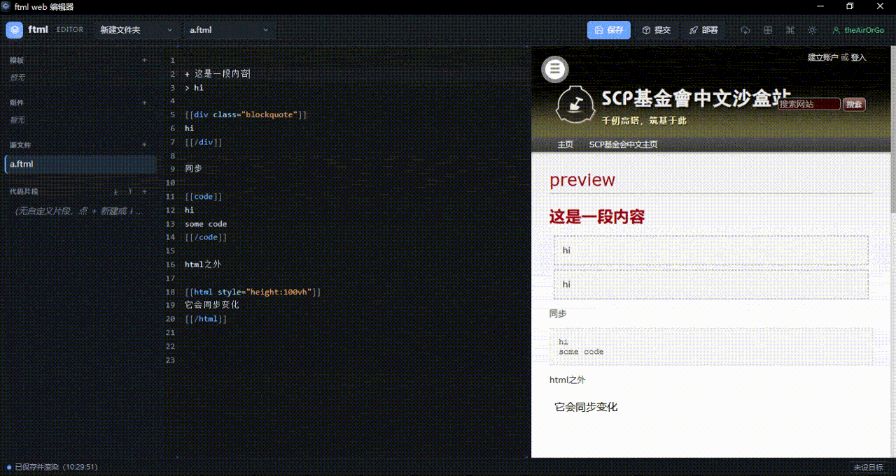

[](https://github.com/r74tech/wdpr)
[](https://github.com/ukwhatn/wikidot-ts)



# ftml-cli

FTML（Wikidot 语法）工作流工具：**模板展开、实时预览、版本管理、一键发布**。
一套引擎，两个入口：**Windows 桌面版** 与 **CLI**，项目、设置与登录凭证完全共用。



## 下载桌面版

**➡ [前往 GitHub Releases 下载最新版](https://github.com/XU-12-song/ftml-cli/releases/latest)**

| 文件 | 说明 |
| --- | --- |
| **`Ftml Editor-<版本>-setup-x64.exe`** | 安装版，注册 `.ftml` 文件关联 |
| `Ftml Editor-<版本>-portable-x64.exe` | 便携版，免安装，不注册关联 |

第一次使用？看 **[5 分钟上手](docs/getting-started.md)**。

> 当前构建未签名，Windows SmartScreen 可能提示。核对下载来源后选择「仍要运行」。

## 它能做什么

- **模板 / 组件复用**：`.ftmx` 模板带参数，`components/` 整段内联，构建时展开为纯 FTML。
- **实时预览**：编辑器右侧即 Wikidot 沙盒站外观，tabview、折叠块、TOC、脚注等可直接交互。
- **本地校验**：div / style / code 配对、模板调用、展开残留；监听改动自动重建。
- **版本管理**：提交出小版本（本地），部署开大版本（上线），任意版本回退本地 + 线上。
- **一键发布**：自动收集 `[[include]]` 依赖页、叶子在前发布、引用名归一到线上全名。
- **离线优先**：远程 include 拉取后写入磁盘缓存；联网刷新由你主动触发。
- **桌面版**：托盘、`.ftml` 文件关联、原生目录选择、窗口状态记忆、随机端口 + 会话 token。

## 5 分钟上手（桌面版）

1. 打开 Ftml Editor，命令面板（`Ctrl+K`）→ **新建 ftml 仓库**。
2. 在 `index.ftml` 里写 FTML，右侧实时预览。
3. `Ctrl+K` → **目标页面设置**，填站点与页面名。
4. **登录 Wikidot**。
5. 点 **部署**。预检摘要确认后，内容发布到线上。

完整步骤：[docs/getting-started.md](docs/getting-started.md)

## 5 分钟上手（CLI）

```bash
git clone https://github.com/XU-12-song/ftml-cli
cd ftml-cli
npm install
npm run build:web
npm link

mkdir my-page && cd my-page
ftml init
ftml preview --open
ftml login
ftml deploy -m "首次发布" --site scpsandboxcn --page my-first-page
```

要求 Node.js >= 20（全 ESM）。`git` 用于提交 / 部署 / 回退，用 `ftml doctor` 体检。

## 文档

| 文档 | 内容 |
| --- | --- |
| [5 分钟上手](docs/getting-started.md) | 从安装到发布第一篇页面 |
| [桌面版](docs/desktop.md) | 安装、托盘、文件关联、数据目录、快捷键 |
| [CLI 命令参考](docs/cli.md) | 全部命令、配置、环境变量、退出码 |
| [版本管理](docs/versions.md) | 提交 / 部署 / 回退的语义与快照 |
| [模板与组件语法](docs/templates.md) | 模板、组件、`[[style]]`、`[[code]]` |
| [Web 编辑器](docs/web-editor.md) | 界面功能、设置、代码片段、HTTP API |
| [常见问题](docs/troubleshooting.md) | 安装、git、登录、发布报错 |
| [开发与构建](docs/development.md) | 脚本、代码结构、测试、打包 |

## 版本模型（一句话）

```text
submit  本地 git commit + 小版本 x.y    不联网
deploy  创建大版本 x + push + 发布线上  + 自动 submit → x.1
revert  本地 git revert + 线上回到对应版本
```

细节见 [版本管理](docs/versions.md)。

## 开发

```bash
npm install
npm run build:web        # 前端产物不入库，克隆后必须先构建
npm test                 # node:test，零额外依赖
npm run typecheck
npm run electron:dev     # 启动桌面版（开发）
npm run dist:win         # 打包 Windows 安装版 + 便携版
```

详见 [开发与构建](docs/development.md)。

## 核心依赖

- [wdpr](https://github.com/r74tech/wdpr)：页面解析 / 渲染 / 预览
- [wikidot-ts](https://github.com/ukwhatn/wikidot-ts)：Wikidot 组件获取与提交

## 致谢

感谢 `wdpr` 和 `wikidot-ts` 的作者及贡献者。

## 许可证

ISC，详见 [LICENSE.md](LICENSE.md)。
第三方依赖及其许可证见 [THIRD-PARTY-LICENSE.md](THIRD-PARTY-LICENSE.md)。
