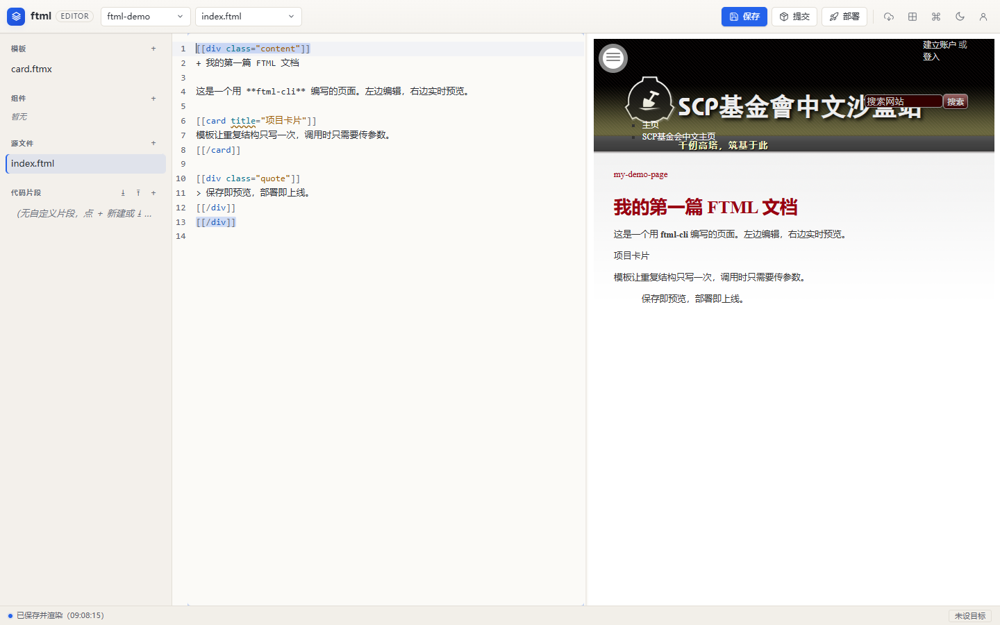
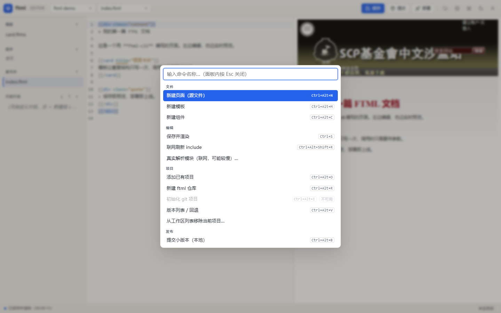

# 桌面版（Windows）

桌面版把同一套 ftml 引擎包进 Electron 外壳：图形界面、实时预览、托盘、文件关联。
数据目录、项目注册表、设置与登录凭证与 CLI 完全共用。

## 下载与安装

到 [GitHub Releases](https://github.com/XU-12-song/ftml-cli/releases/latest) 下载：

| 文件 | 说明 |
| --- | --- |
| `Ftml Editor-<版本>-setup-x64.exe` | 安装版。可选安装目录，创建开始菜单 / 桌面快捷方式，注册 `.ftml` 文件关联 |
| `Ftml Editor-<版本>-portable-x64.exe` | 便携版。免安装，**不会**注册文件关联 |

当前构建**未签名**。Windows SmartScreen 首次运行可能提示「已保护你的电脑」，核对下载来源后选择「仍要运行」。

## 第一次启动

没有项目时，应用会显示欢迎面板，提供三个入口：

- **新建 ftml 仓库**：在 `~/.ftml-cli/projects/`（或你选择的父目录）下创建并初始化项目。
- **添加已有项目**：用系统目录选择器打开已有 FTML 目录。
- **登录 Wikidot**：发布前需要。

欢迎面板只是引导，之后随时可以用 `Ctrl+K` 命令面板完成同样的操作。

## 界面速览



- 顶部：项目 / 源文件下拉，保存、提交、部署，联网刷新、布局、主题、登录。
- 左侧栏：模板、组件、源文件、代码片段。
- 中间：源码编辑器（CodeMirror 6）。
- 右侧：实时预览 iframe，外观对齐 Wikidot 沙盒站。
- 底部状态栏：保存状态、目标页面。



按 `Ctrl+K` 打开命令面板；它也是所有功能的完整目录，包括没有放在顶栏的「目标页面设置」「版本列表 / 回退」「初始化 git 项目」。

## 窗口与托盘

- **最小化 → 隐藏到托盘**；**点关闭 → 退出应用**。
- 托盘菜单可恢复窗口、打开项目或退出。
- 原生菜单栏默认自动隐藏，按 `Alt` 显示。
- 窗口标题栏跟随应用的深 / 浅主题。
- 窗口位置、大小会记住（`~/.ftml-cli/window-state.json`）。

## 文件关联

- 双击 `.ftml` 文件：如果它所在的目录是项目根（含 `.ftml`、`templates` 或 `components`），直接打开。
- 如果只是松散文件，会先询问是否把所在目录添加为工作区，避免打开几次就注册一堆项目。
- 安装版注册关联；便携版不注册，可手动拖入应用或通过「添加已有项目」打开。

## 项目管理

- 顶栏项目下拉可切换已注册项目。
- 「从工作区列表移除当前项目」只取消注册，**不删除任何文件**。
- 「新建仓库」与「添加项目」在桌面版使用系统原生目录选择器；浏览器版 `ftml web` 使用路径输入框。
- 「初始化 git 项目」会为当前目录补上 `.ftml/`、`.gitignore` 和 `git init`。

## 安全与网络

- 打开的窗口地址是 `127.0.0.1` 上的随机端口，并带一次性会话 token，不会暴露到局域网。
- 预览默认离线：本地文件和磁盘缓存优先；只有点击「联网刷新 include」或「真实解析模块」才联网。
- Wikidot 凭证保存在 `~/.ftml-cli/credentials.json`（`0600`），与 CLI 共用。

## 数据目录

默认 `~/.ftml-cli`，可用环境变量 `FTML_CLI_HOME` 重定向：

```text
~/.ftml-cli/
  credentials.json          登录凭证
  cache/<site>/<page>.ftml  远程 include 缓存
  settings.json             编辑器设置
  snippets/snippets.json    代码片段
  projects.json             项目注册表
  projects/<仓库名>/        「新建仓库」默认分区
  window-state.json         窗口位置 / 大小
```

## 快捷操作

| 操作 | 快捷键 |
| --- | --- |
| 命令面板 | `Ctrl+K` |
| 保存并渲染 | `Ctrl+S` |
| 提交小版本 | `Ctrl+Alt+B` |
| 部署（创建大版本） | `Ctrl+Alt+P` |
| 版本列表 / 回退 | `Ctrl+Alt+V` |
| 目标页面设置 | `Ctrl+Alt+U` |
| 新建页面 | `Ctrl+Alt+N` |
| 新建模板 | `Ctrl+Alt+M` |
| 新建组件 | `Ctrl+Alt+C` |
| 联网刷新 include | `Ctrl+Alt+Shift+R` |
| 切换布局 | `Ctrl+Alt+S` |
| 禅模式 | `Ctrl+Shift+F` |
| 登录 / 退出 Wikidot | `Ctrl+Alt+A` |

完整命令列表以命令面板为准。

## 从源码运行

```bash
npm install
npm run build:web        # 构建前端
npm run build:electron   # 构建主进程
electron .               # 或 npm run electron:dev（自动先构建）
```

打包 Windows 安装包与便携版：

```bash
npm run dist:win         # 输出到 release/
```

## 卸载

- 安装版：通过「设置 → 应用」卸载。项目文件不会被删除。
- 便携版：直接删除 exe。
- 如需彻底清理用户数据，删除 `~/.ftml-cli`（**会删除凭证、缓存、项目注册表，请先备份**）。
