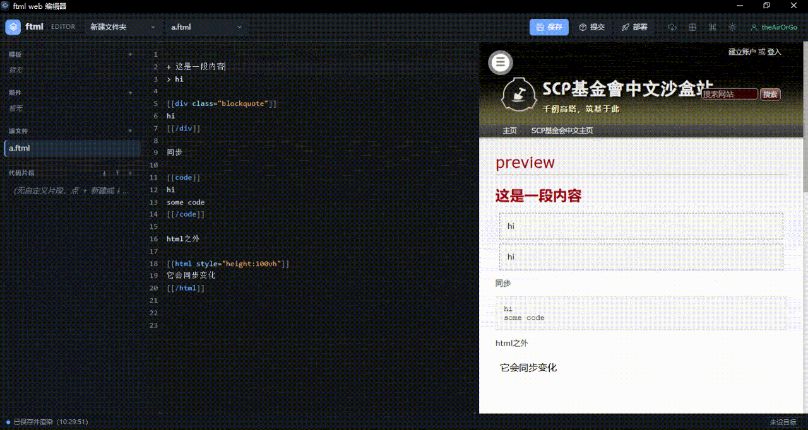

# 5 分钟上手

这篇文档做的事：带你从零写出第一篇能在本地预览、并发布到 Wikidot 的页面。

## 0. 选择入口

| 入口 | 适合 |
| --- | --- |
| **Windows 桌面版** | 大多数写作者：下载即用，图形界面，实时预览 |
| **CLI** | 习惯终端、想接入脚本 / CI 的用户，geek kid |

两个入口操作的是同一批项目文件，可以随时切换。

## 1. 安装桌面版

1. 打开 [GitHub Releases](https://github.com/XU-12-song/ftml-cli/releases/latest)。
2. 下载 `Ftml Editor-<版本>-setup-x64.exe`（安装版）或 `Ftml Editor-<版本>-portable-x64.exe`（便携版）。
3. 运行。Windows SmartScreen 可能提示 "已保护你的电脑" 因为当前构建未签名，核对下载来源后选择"仍要运行"，请勿担心，这是正常的。

安装版会注册 `.ftml` 文件关联；便携版不会

## 2. 创建第一个项目

打开应用后：

1. 按 `Ctrl+K` 打开命令面板。
2. 选择 **新建 ftml 仓库**（已经有一个 FTML 目录则选 **添加已有项目**）。
3. 输入仓库名，例如 `my-first-page`。默认创建在 `~/.ftml-cli/projects/` 下。

一个项目会包含：

```text
my-first-page/
  index.ftml        入口源文件
  templates/        模板（.ftmx）
  components/       组件（.ftml）
  .ftml/            版本、历史等项目数据
  .ftmlrc.json      项目配置
```

> 没有项目时，应用会先显示一个欢迎面板，引导你新建仓库或打开已有目录。

## 3. 认识编辑器



- **左侧**：模板 / 组件 / 源文件 / 代码片段。
- **中间**：FTML 源码编辑器
- **右侧**：实时预览。
- **顶部**：保存、提交、部署。
- **底部**：状态与当前部署目标。

输入时默认自动保存并刷新预览。

## 4. 写第一篇页面

将以下内容粘贴到 `index.ftml` 

```ftml
[[div class="content"]]
+ 我的第一篇 FTML 文档

这是一个用 **ftml-cli** 编写的页面。左边编辑，右边实时预览。

[[div class="blockquote"]]
保存即预览，部署即上线。
[[/div]]
[[/div]]
```

保存后，右侧应该立刻出现标题和引用块。

### 模板

这里也支持创建wikidot语法的组件，一样的，可以使用include引用，如 `[[include path/file]]` 从项目根出发，不需要带上.ftml文件名后缀

新建模板 `templates/card.ftmx`：

```ftml
[[div class="block"]]
{ title }

{ children }
[[/div]]
```

然后在 `index.ftml` 里调用：

```ftml
[[card title="项目卡片"]]
模板让重复结构只写一次，调用时只需要传参数。
[[/card]]
```

保存，预览里就会多出一个卡片。模板语法细节见 [模板与组件语法](templates.md)。

## 5. 设置要发布的页面

部署前必须告诉设置发布目标：

1. 按 `Ctrl+K`，选择 **目标页面设置**。
2. 填写：
   - **Wikidot 站点**：站点子域名，例如 `scpsandboxcn` 对应 `scpsandboxcn.wikidot.com`。
   - **页面名**：页面名，例如 `my-first-page`。
3. 保存。状态栏右下角会显示当前目标。

每个源文件单独记忆目标页面。

## 6. 登录 Wikidot

按 `Ctrl+K` → **登录 Wikidot**，输入用户名和密码。凭证保存在 `~/.ftml-cli/credentials.json`，权限 `0600`。

也可以用命令行方法：

```bash
export WIKIDOT_USERNAME='你的用户名'
export WIKIDOT_PASSWORD='你的密码'
ftml login --env
```

## 7. 提交 / 部署

这是两个不同动作，别混用：

| 动作 | 做什么 | 联网 | 适合 |
| --- | --- | --- | --- |
| **提交**（`Ctrl+Alt+B`） | 本地 git commit + 小版本号 | 否 | 保存进度、本地备份 |
| **部署**（`Ctrl+Alt+P`） | 创建大版本 + push + 发布 Wikidot + 再提交一次 | 是 | 把当前内容发到线上 |

第一次发布点 **部署**。部署前会显示预检摘要：目标页面、将要创建的版本号、是否推送、是否发布依赖页。

部署成功后，线上页面就是当前预览的内容。以后想回退，按 `Ctrl+Alt+V` 打开版本列表。版本语义见 [版本管理](versions.md)。

> 入口页面必须**已经存在于线上**，部署不会自动创建正页。依赖页（项目里被 `[[include]]` 的本地页面）不存在时会自动创建。

## CLI 用户的最短路径

```bash
git clone https://github.com/XU-12-song/ftml-cli
cd ftml-cli
npm install
npm run build:web
npm link

mkdir my-page && cd my-page
ftml init                     # 项目结构 + 起始 index.ftml + git init
ftml preview --open           # 构建并打开本地预览
ftml login                    # 登录 Wikidot
ftml deploy -m "首次发布" --site scpsandboxcn --page my-first-page
```

常用命令：

```bash
ftml build                    # 展开模板 → dist/index.ftml
ftml validate                 # 校验语法
ftml watch                    # 改文件自动重建
ftml web --open               # 启动浏览器版编辑器
ftml revert --list            # 查看版本
```

完整命令见 [CLI 命令参考](cli.md)。

## 接下来

- [版本管理](versions.md)：提交、部署、回退到底有什么区别。
- [模板与组件语法](templates.md)：把页面拆成可复用的块。
- [常见问题](troubleshooting.md)：报错时先看这里。
